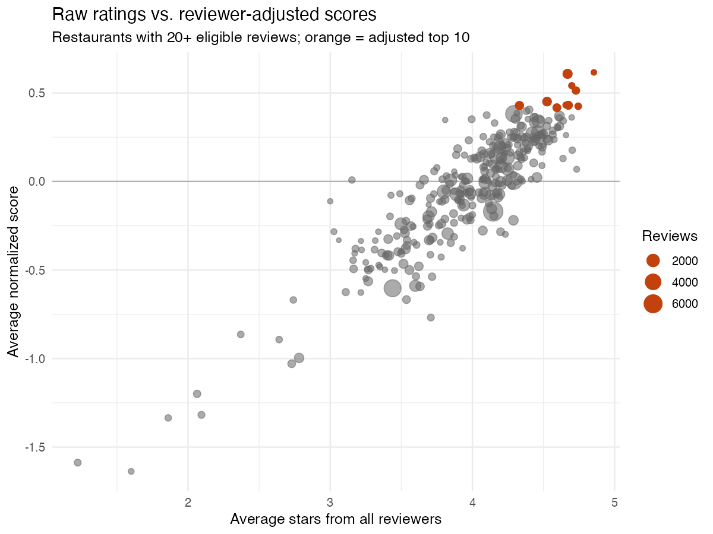

# Where to Find the Best Breakfast and Coffee in New Orleans

## [Read the final report (PDF)](docs/yelp_new_orleans_project.pdf)

[Download the PDF directly](https://github.com/babaJaan01/yelp-new-orleans-project/raw/refs/heads/main/docs/yelp_new_orleans_project.pdf) · [HTML version (download to view)](docs/yelp_new_orleans_project.html) · [Quarto source with all code](yelp_new_orleans_project.qmd)

**Research question:** Where in New Orleans can someone find the best breakfast and coffee restaurants, and which geographic area is best for finding them?

Shayaan Tanveer · MATH 167R Project 2 · R + Quarto + Yelp Open Dataset

The report is the complete argument: the data, my choices, the spatial analysis, and the reviewer-adjusted ranking. This README is the short version.

| In the report | Section |
|---|---|
| Data handling for the 5 GB review file | Large-data management |
| Category choice and evidence | Step 3 |
| Official boundary and spatial join | Step 5 |
| ZIP codes vs. census tracts, and my choice | Step 6 |
| Reviewer-adjusted scores, top 10, final answer | Step 7 |
| Limitations and AI prompts | Last two sections |

## Answer in brief

- **Best area: ZIP 70117** (Bywater / Marigny / St. Roch). It ranks first both on raw Yelp stars and after adjusting for each reviewer's scoring habits. The margin is small: Mid-City (70119) and Uptown (70115) are right behind it.
- **Most choice: ZIP 70130** (downtown / CBD), with the most restaurants and reviews, but a lower average rating (3.85 stars among established restaurants).
- **Top 10 restaurants** are listed below, ranked by reviewer-adjusted score.


## Top 10 restaurants

Ranked by average reviewer-adjusted score among restaurants with 20+ reviews from reviewers who have at least 5 reviews.

| # | Restaurant | ZIP | Raw avg stars | Adjusted score | Eligible reviews |
|--:|---|---|--:|--:|--:|
| 1 | Park Island Brew | 70119 | 4.85 | +0.62 | 24 |
| 2 | Angelo Brocato | 70119 | 4.67 | +0.61 | 284 |
| 3 | Coffee Science | 70119 | 4.70 | +0.54 | 37 |
| 4 | Piccola Gelateria | 70115 | 4.73 | +0.51 | 97 |
| 5 | Paladar 511 | 70117 | 4.52 | +0.45 | 158 |
| 6 | Sólo Espresso | 70117 | 4.66 | +0.43 | 25 |
| 7 | Welty's Deli and Catering | 70130 | 4.67 | +0.43 | 95 |
| 8 | Dong Phuong | 70129 | 4.33 | +0.43 | 156 |
| 9 | Fatma's Cozy Corner | 70116 | 4.74 | +0.42 | 24 |
| 10 | Two Chicks Café - CBD | 70112 | 4.59 | +0.42 | 35 |

The adjusted score is the review's stars minus that reviewer's own average, so +0.5 means reviewers rated the place half a star above their usual.

## My decisions and the reasons behind them

| Decision | Choice | Why | Reservation |
|---|---|---|---|
| Theme | Breakfast & brunch, coffee & tea, cafes, bakeries | One occasion (a morning stop); co-occur heavily, e.g. 85 places are both breakfast & coffee. | Includes some bars and delis that also serve breakfast. |
| City boundary | Inside the official Census boundary: 564 of 575 | 11 Yelp "New Orleans" labels are Jefferson Parish suburbs. | One restaurant has coordinates that look wrong. |
| Geography | ZIP codes (18 areas) | Enough restaurants per area (median 14) and familiar to readers. | ZIPs are postal units, not neighborhoods. |
| Reviewer baseline | Mean, reviewers with 5+ reviews | 3,398 reviewers, 19% of reviews; mean is finer than a median on whole stars. | Baselines rest on few reviews. |
| Ranking | Adjusted score, 20+ eligible reviews | Reduces the effect of generous or harsh reviewers. | Several top-10 places have only 24 to 37 eligible reviews. |

Data: 2,259 New Orleans restaurants and 476,421 reviews (the full set, not a sample).

| Geographic system | Areas | Restaurants assigned | Unmatched | Smallest | Median | Largest | Areas with < 5 |
|---|--:|--:|--:|--:|--:|--:|--:|
| ZIP/ZCTA | 18 | 564 | 0 | 1 | 14 | 146 | 3 |
| Census tract | 103 | 564 | 0 | 1 | 2 | 117 | 75 |

ZIP codes win because tracts are so small that most have only one or two restaurants, which is too few to compare. ZIPs are also areas readers already know.




## What the adjustment changed

- Raw and adjusted rankings mostly agree (rank correlation 0.86), but individual restaurants move a lot. Dong Phuong rises from #70 to #8, while Catalino's falls from #3 to #127, because its high raw rating came from very generous reviewers.
- The top 10 is **not stable**: using a 3- or 10-review cutoff instead of 5 keeps only 5 of the 10. The ZIP-level answer is steadier than the exact restaurant order.

## Limitations

Yelp reviewers are self-selected, reviewer baselines rest on few reviews, ZIP areas are postal units rather than neighborhoods, and the data is a snapshot. Neighborhood areas and wards were not tested. See the report for details.

## Reproduce it

The raw Yelp files are several GB, so they are not in the repo. The reviews file (`reviews_new_orleans.rds`) is also left out because it contains review text.

1. Download the Yelp Open Dataset from <https://business.yelp.com/data/resources/open-dataset/> and extract `yelp_academic_dataset_business.json` and `yelp_academic_dataset_review.json` from `yelp_dataset.tar` into `data/raw/`.
2. From the repository root, run:

```sh
Rscript R/import.R
quarto render yelp_new_orleans_project.qmd --output-dir docs
```

The import step filters the 5 GB review file in chunks (about 6 minutes). Rendering needs `tidyverse`, `sf`, `tigris`, `viridis`, `patchwork`, `ggrepel` and an internet connection for the Census boundaries.

## Files

- [R/import.R](R/import.R): imports the raw JSON in chunks, filters to New Orleans, saves RDS files
- [yelp_new_orleans_project.qmd](yelp_new_orleans_project.qmd): the full analysis and report
- [docs/](docs/): rendered HTML and PDF report
- [figures/](figures/): saved maps and plots
- [data/new_orleans/](data/new_orleans/): filtered business data
- [yelp new orleans project instructions.qmd](<yelp new orleans project instructions.qmd>): the assignment

## AI assistance

I used AI to help write and check the Step 7 code and to make sure I could explain the results. These are the actual prompts I used (also in the report).

These are the prompts I used while building Step 7 and writing it up, quoted as I wrote them. Each one maps to a part of the report.

#### 1. Building the reviewer-adjusted score (Step 7 code)

> In my New Orleans breakfast/coffee project, I want to rank restaurants by a reviewer-adjusted score, not raw stars. The idea is: for each reviewer with at least 5 reviews, compute their average star rating; then for each review, subtract that reviewer's average from the stars they gave; then average those adjusted values per restaurant, keeping only restaurants with 20+ eligible reviews. Can you write the  pipeline for this and explain what each step does?

Used for: the `reviewer_baselines`, `adjusted_reviews()` and `restaurant_summary` chunks.

#### 2. Making sure I understand the code I submit

> I have this chunk in my Quarto file and I want to be able to explain it in my write-up. Can you walk through it line by line and tell me what inner_join and mutate are doing here, and why the inner_join matters for which reviews survive?

Used for: the explanation of how only reviews from eligible reviewers (5+ reviews) are kept.

#### 3. Explaining the results in plain language

> I need to explain in plain language what a reviewer-adjusted score of +0.62 means for a restaurant, and why the raw and adjusted rankings mostly agree (rank correlation 0.86) but some restaurants move dramatically. Can you explain the concept and give a concrete example from my results?

Used for: the "What the adjustment changed" discussion (for example Dong Phuong moving from #70 to #8).

#### 4. Checking that my conclusions are consistent

> My report says ZIP codes are the right geographic unit and also that the top-10 restaurant ranking isn't very stable. Can you explain how those two claims fit together, why the top-10 changes when I switch the review cutoff from 5 to 3 or 10, and what that means for how I should state my conclusion?

Used for: the final answer, where I state that the area result is steadier than the exact top-10 order.
