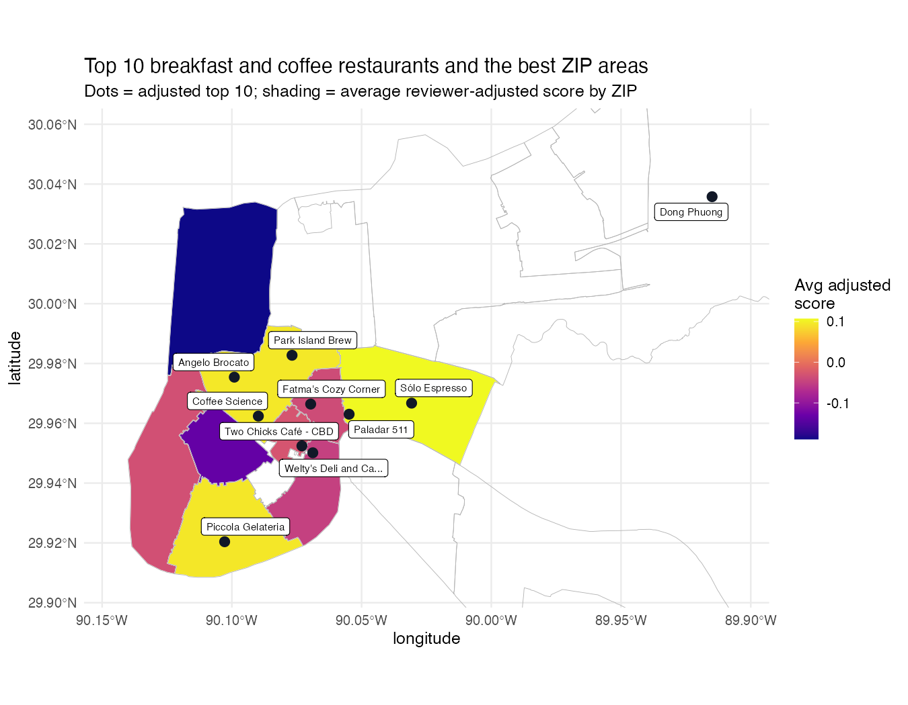

# Where to Find the Best Breakfast and Coffee in New Orleans

MATH 167R Project 2 · Yelp Open Dataset

**Research question:** Where in New Orleans can someone find the best breakfast and coffee restaurants, and which geographic area is best for finding them?

**Full report:** [PDF](docs/yelp_new_orleans_project.pdf) · [HTML (download to view)](docs/yelp_new_orleans_project.html) · [Quarto source with all code](yelp_new_orleans_project.qmd)

## Answer in brief

- **Best area: ZIP 70117** (Bywater / Marigny / St. Roch). It ranks first both on raw Yelp stars and after adjusting for each reviewer's scoring habits. The margin is small: Mid-City (70119) and Uptown (70115) are right behind it.
- **Most choice: ZIP 70130** (downtown / CBD), with the most restaurants and reviews, but a lower average rating (3.85 stars among established restaurants).
- **Top 10 restaurants** are listed below, ranked by reviewer-adjusted score.

## Top 10 restaurants

Ranked by average reviewer-adjusted score among restaurants with 20+ reviews from reviewers who have at least 5 reviews.

| # | Restaurant | ZIP | Raw avg stars | Adjusted score | Eligible reviews |
|--:|---|---|--:|--:|--:|
| 1 | Park Island Brew | 70119 | 4.85 | +0.62 | 24 |
| 2 | Angelo Brocato | 70119 | 4.67 | +0.61 | 284 |
| 3 | Coffee Science | 70119 | 4.70 | +0.54 | 37 |
| 4 | Piccola Gelateria | 70115 | 4.73 | +0.51 | 97 |
| 5 | Paladar 511 | 70117 | 4.52 | +0.45 | 158 |
| 6 | Sólo Espresso | 70117 | 4.66 | +0.43 | 25 |
| 7 | Welty's Deli and Catering | 70130 | 4.67 | +0.43 | 95 |
| 8 | Dong Phuong | 70129 | 4.33 | +0.43 | 156 |
| 9 | Fatma's Cozy Corner | 70116 | 4.74 | +0.42 | 24 |
| 10 | Two Chicks Café - CBD | 70112 | 4.59 | +0.42 | 35 |

The adjusted score is the review's stars minus that reviewer's own average, so +0.5 means reviewers rated the place half a star above their usual.

## How I got there

1. **Data.** 2,259 New Orleans restaurants and 476,421 reviews from the Yelp Open Dataset (full set, not a sample).
2. **Categories.** Breakfast & brunch, coffee & tea, cafes and bakeries: 575 restaurants, 564 inside the official city boundary (11 "New Orleans" labels in Yelp are actually suburbs).
3. **Geography.** ZIP codes vs. census tracts (table below). I chose ZIP codes.
4. **Reviewer adjustment.** 3,398 reviewers have 5+ reviews and write 19% of the reviews.

| Geographic system | Areas | Restaurants assigned | Unmatched | Smallest | Median | Largest | Areas with < 5 |
|---|--:|--:|--:|--:|--:|--:|--:|
| ZIP/ZCTA | 18 | 564 | 0 | 1 | 14 | 146 | 3 |
| Census tract | 103 | 564 | 0 | 1 | 2 | 117 | 75 |

ZIP codes win because tracts are so small that most have only one or two restaurants, which is too few to compare. ZIPs are also areas readers already know.

## What the adjustment changed

- Raw and adjusted rankings mostly agree (rank correlation 0.86), but individual restaurants move a lot. Dong Phuong rises from #70 to #8, while Catalino's falls from #3 to #127, because its high raw rating came from very generous reviewers.
- The top 10 is **not stable**: using a 3- or 10-review cutoff instead of 5 keeps only 5 of the 10. The ZIP-level answer is steadier than the exact restaurant order.

## Limitations

Yelp reviewers are self-selected, reviewer baselines rest on few reviews, ZIP areas are postal units rather than neighborhoods, and the data is a snapshot. Neighborhood areas and wards were not tested. See the report for details.

## Reproduce it

The raw Yelp files are several GB, so they are not in the repo. The reviews file (`reviews_new_orleans.rds`) is also left out because it contains review text.

1. Download the Yelp Open Dataset: <https://business.yelp.com/data/resources/open-dataset/>.
2. Extract `yelp_academic_dataset_business.json` and `yelp_academic_dataset_review.json` from `yelp_dataset.tar` into `data/raw/`.
3. Run `Rscript R/import.R` to create the filtered `.rds` files in `data/new_orleans/`.
4. Run `quarto render yelp_new_orleans_project.qmd --output-dir docs` (needs `tidyverse`, `sf`, `tigris`, `viridis`, `patchwork`, `ggrepel`, and internet for Census boundaries).

## Files

- [R/import.R](R/import.R): imports the raw JSON in chunks, filters to New Orleans, saves RDS files
- [yelp_new_orleans_project.qmd](yelp_new_orleans_project.qmd): the full analysis and report
- [docs/](docs/): rendered HTML and PDF report
- [figures/](figures/): saved maps and plots
- [data/new_orleans/](data/new_orleans/): filtered business data
- [yelp new orleans project instructions.qmd](<yelp new orleans project instructions.qmd>): the assignment

## AI prompts used

_To be added._
