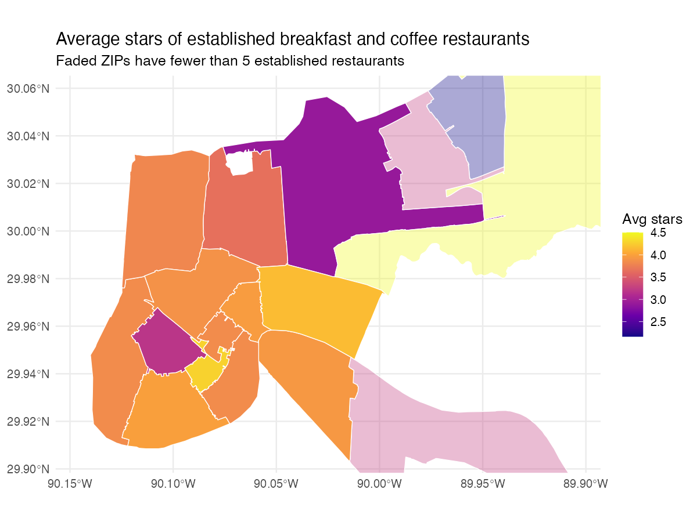
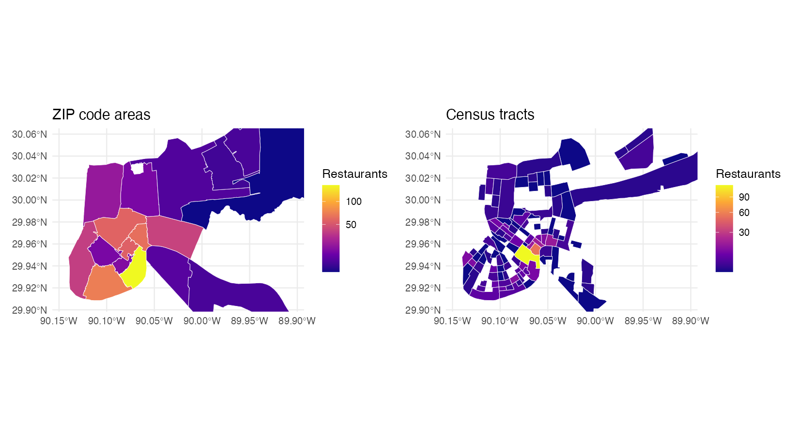

# Where to Find the Best Breakfast and Coffee in New Orleans

MATH 167R Project 2, Yelp Open Dataset. This is the Steps 1-6 version; reviewer-adjusted scores (Step 7) are still to come.

**Research question:** Where in New Orleans can someone find the best breakfast and coffee restaurants, and which geographic area is best for finding them?

## Report

- **Full report (source, with all code):** [yelp_new_orleans_project.qmd](yelp_new_orleans_project.qmd)
- **Rendered HTML report (self-contained, download it to view):** [docs/yelp_new_orleans_project.html](docs/yelp_new_orleans_project.html)
- Maps and plots are saved in [figures/](figures/) and embedded below.

## Summary

I selected four related categories (breakfast & brunch, coffee & tea, cafes, bakeries), which gives 575 restaurants labelled "New Orleans" by Yelp, 564 of them inside the official city boundary. I compared ZIP code areas (18 areas, median 14 restaurants each) with census tracts (103 areas, median 2 each) and chose **ZIP code areas**, since tracts are too small to rank fairly.

## Findings

1. **Best area for quality: ZIP 70117** (Bywater / Marigny / St. Roch). Established restaurants (20+ reviews) average 4.15 stars across 33 restaurants. ZIP 70113 averages higher (4.28) but on only 9 established restaurants.
2. **Best area for variety: ZIP 70130** (CBD / Warehouse District). It has 146 breakfast and coffee restaurants and about 77,000 Yelp reviews, but a lower 3.85 average.
3. **Yelp's "New Orleans" label is not exactly the city.** 11 restaurants labelled New Orleans fall in Jefferson Parish suburbs, so I used the official Census boundary.

## Geographic comparison

| Geographic system | Areas with a restaurant | Restaurants assigned | Unmatched | Smallest | Median | Largest | Areas with < 5 |
|---|---:|---:|---:|---:|---:|---:|---:|
| ZIP/ZCTA | 18 | 564 | 0 | 1 | 14 | 146 | 3 |
| Census tract | 103 | 564 | 0 | 1 | 2 | 117 | 75 |

## Getting the data

The raw Yelp JSON files are several GB, so they are not committed (`data/raw/` is in `.gitignore`).

1. Download the Yelp Open Dataset from <https://business.yelp.com/data/resources/open-dataset/>.
2. Unzip it and extract `yelp_academic_dataset_business.json` and `yelp_academic_dataset_review.json` from `yelp_dataset.tar` into `data/raw/`.
3. From the project root, run `Rscript R/import.R`. This filters to New Orleans restaurants and their reviews and saves them to `data/new_orleans/` as compressed `.rds` files. The reviews file (`reviews_new_orleans.rds`) contains Yelp review text, so it is not committed; running the script recreates it.
4. Render the report with `quarto render yelp_new_orleans_project.qmd --output-dir docs` (needs R packages `tidyverse`, `sf`, `tigris`, `viridis`, `patchwork`, `ggrepel`, and an internet connection for the Census boundaries).

## Files

- `R/import.R`: imports the raw JSON, filters to New Orleans restaurants, saves RDS files
- `yelp_new_orleans_project.qmd`: the report (Steps 1-6)
- `docs/`: rendered HTML report
- `data/new_orleans/`: filtered data (the business file only is committed)
- `figures/`: saved plots and maps
- `yelp new orleans project instructions.qmd`: the assignment instructions
