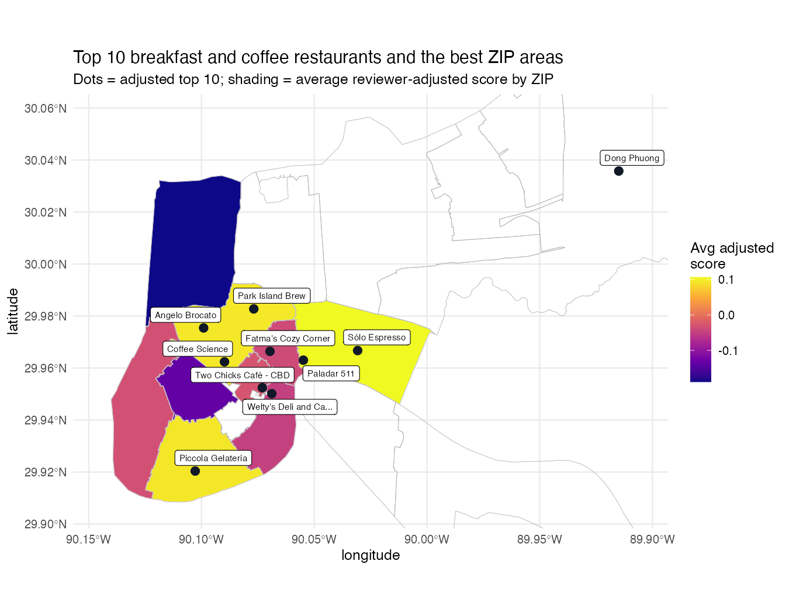
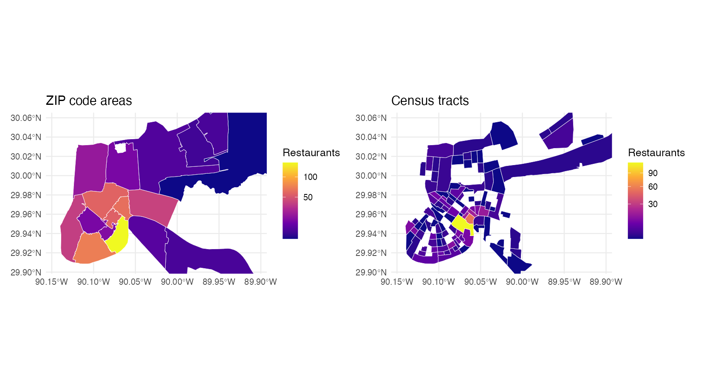
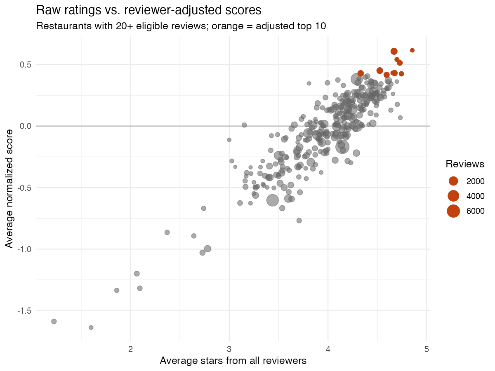

```{r}
#| include: false
# Reads tables written by yelp_new_orleans_project.qmd (run that first).
library(dplyr)
tbl <- function(df, ...) cat(knitr::kable(df, format = "pipe", ...), sep = "\n")
top10 <- read.csv("results/top10.csv")
geo <- read.csv("results/geography_comparison.csv", check.names = FALSE)
thr <- read.csv("results/threshold_table.csv", check.names = FALSE)
zip <- read.csv("results/zip_adjusted.csv", check.names = FALSE)
k <- read.csv("results/key_numbers.csv")
```

> **Where in New Orleans can someone find the best breakfast and coffee restaurants, and which geographic area is best for finding them?**

```{=typst}
#result-card([Best area for quality], [ZIP 70117])
#result-card([Best area for variety], [ZIP 70130])
#result-card([Top-rated restaurant], [Park Island Brew])
```

## The short answer

**ZIP 70117** (Bywater / Marigny / St. Roch) is the best area for finding breakfast and coffee. It ranks first on raw Yelp stars *and* after adjusting for each reviewer's scoring habits. The margin is small: Mid-City (70119) and Uptown (70115) are about 0.01 behind on the adjusted score. The downtown ZIP **70130** has by far the most choices but a lower average rating.

{width=62%}

## Top 10 restaurants

Ranked by average **reviewer-adjusted score**: each review's stars minus that reviewer's own average, so +0.5 means reviewers rated the place half a star above their usual. Only restaurants with 20+ reviews from reviewers who have written at least 5 reviews are ranked.

```{r}
top10 |>
  transmute(`#` = rank, Restaurant = restaurant, ZIP = zip, `Raw stars` = raw_stars,
            `Adjusted` = sprintf("%+.2f", adjusted), `Eligible reviews` = eligible_reviews) |>
  tbl()
```

## How I chose

- **Data.** The full Yelp Open Dataset: `r format(k$restaurants_in_city, big.mark = ",")` breakfast and coffee restaurants inside the official New Orleans boundary and `r format(k$all_reviews, big.mark = ",")` reviews. The 5 GB review file was filtered in chunks so it never had to fit in memory.
- **Categories.** Breakfast & brunch, coffee & tea, cafes and bakeries. They describe one occasion (a morning stop) and overlap heavily: 85 restaurants are both breakfast & brunch and coffee & tea.
- **City boundary.** Of 575 restaurants Yelp labels "New Orleans", 11 are in Jefferson Parish suburbs, so I kept only points inside the Census place boundary.
- **Geography.** I compared ZIP codes with census tracts and chose ZIP codes.

```{r}
tbl(geo)
```

Tracts are so small that most hold only one or two restaurants, which is too few to compare fairly. ZIP codes give a median of 14 restaurants per area and are areas readers already know. They are postal units, not neighborhoods, so some detail inside large ZIPs is hidden.

{width=92%}

## What the reviewer adjustment changed

Only `r format(k$eligible_reviewers, big.mark = ",")` reviewers have 5+ reviews, but they write `r round(100 * k$eligible_reviews / k$all_reviews)`% of the reviews. The adjusted and raw rankings mostly agree (rank correlation `r round(k$rank_correlation, 2)`), but individual restaurants move a lot:

- **Dong Phuong** rises from #70 to #8 and **Paladar 511** from #26 to #5, because their reviewers usually rate other places lower.
- **Catalino's** falls from #3 to #127: its 4.73 raw average came from reviewers who give nearly everyone high ratings.

{width=78%}

```{r}
tbl(zip, caption = "ZIP areas with 5+ restaurants that have 20+ eligible reviews")
```

### How stable is the answer?

```{r}
tbl(thr, caption = "Changing the minimum number of reviews per reviewer")
```

The exact top 10 is **not stable**: a 3- or 10-review cutoff keeps only 5 of the 10 restaurants. The ZIP-level result is steadier than the restaurant order, so I trust the area conclusion more than the exact list.

## Limitations

- Yelp reviewers are self-selected, so ratings reflect who chose to review, not every diner.
- Reviewer baselines rest on few reviews and include the review being adjusted.
- Several top-10 restaurants have only 24 to 37 eligible reviews.
- ZIP areas are postal units; Neighborhood Statistical Areas and wards were not tested.
- The data is a snapshot, and some Yelp coordinates look wrong.

## AI assistance and prompts

I used AI to help write and check the Step 7 code and to make sure I could explain the results. These are the prompts I used, as written.

**1. Building the adjusted score**

> In my New Orleans breakfast/coffee project, I want to rank restaurants by a reviewer-adjusted score, not raw stars. The idea is: for each reviewer with at least 5 reviews, compute their average star rating; then for each review, subtract that reviewer's average from the stars they gave; then average those adjusted values per restaurant, keeping only restaurants with 20+ eligible reviews. Can you write the  pipeline for this and explain what each step does?

**2. Understanding the code I submit**

> I have this chunk in my Quarto file and I want to be able to explain it in my write-up. Can you walk through it line by line and tell me what inner_join and mutate are doing here, and why the inner_join matters for which reviews survive?

**3. Explaining the results**

> I need to explain in plain language what a reviewer-adjusted score of +0.62 means for a restaurant, and why the raw and adjusted rankings mostly agree (rank correlation 0.86) but some restaurants move dramatically. Can you explain the concept and give a concrete example from my results?

**4. Checking my conclusions are consistent**

> My report says ZIP codes are the right geographic unit and also that the top-10 restaurant ranking isn't very stable. Can you explain how those two claims fit together, why the top-10 changes when I switch the review cutoff from 5 to 3 or 10, and what that means for how I should state my conclusion?

Code, data-handling details and the full analysis: [github.com/babaJaan01/yelp-new-orleans-project](https://github.com/babaJaan01/yelp-new-orleans-project).
